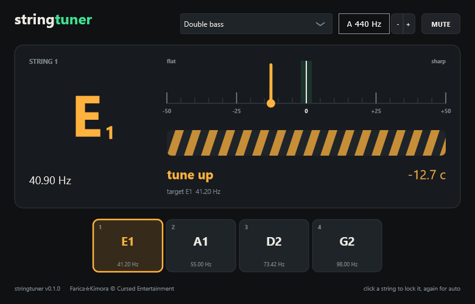

# stringtuner

A tuner for every string instrument, from the octobass (C0, 16 Hz) to the top of the piano
(C8, 4186 Hz). VST3 plugin and a standalone app with ASIO, for Windows.

**Website (with a tuner you can try in the browser):** https://cursedprograms.github.io/stringtuner/
&middot; **Download:** [latest release](https://github.com/CursedPrograms/stringtuner/releases/latest)

[Farica☆Kimora](https://github.com/Farica-Kimora) © Cursed Entertainment

## What it does
- **Pick your instrument** and it shows its open strings; play one and the nearest string lights up.
  Click a string to lock the tuner to it (handy when you're far off), click again for auto.
- **Chromatic mode** for anything else: harp, piano, a sitar you tuned your own way.
- **Needle and strobe:** the needle shows cents, the stripes drift right when you're sharp,
  left when you're flat, and stand still when you're in tune (green within 2 cents).
- **A4 reference** from 415 Hz (baroque) to 466 Hz.
- **MUTE** silences the output while you tune; otherwise the sound passes straight through.

### Instruments
| Bowed | Guitar | Bass | Small | Folk |
|---|---|---|---|---|
| Violino piccolo (Bach) | Guitar | Bass, 4-string | Ukulele | Banjo, 5-string (open G) |
| Violin | Guitar, drop D | Bass, 5-string | Ukulele, low G | Bouzouki (Irish) |
| Viola | Guitar, 7-string | Bass, 6-string | Baritone ukulele | |
| Cello | Guitar, 8-string | Bass, drop D | Mandolin | |
| Double bass (also low C, 5-string, solo tuning) | Baritone guitar | | Mandola | |
| Octobass | | | Cavaquinho | |
| Viola da gamba (bass), Erhu | | | Balalaika (prima) | |

## How it hears the pitch
YIN pitch detection with the difference function computed by FFT, so the long window the lowest
strings need (about a fifth of a second, 40,000 samples at 192 kHz) stays cheap, then measured
again exactly across as many periods as fit for sub-cent accuracy on the highest notes. A big string with a weak fundamental
doesn't fool it into reading an octave up.

Tested offline (`tools/check.cpp`) on every semitone from C0 to C8 at 44.1, 48, 96 and 192 kHz:
within **0.4 cents** everywhere; weak fundamentals within 0.2 cents; one reading takes under 1 ms
at 48 kHz. Very stiff low strings (piano, low B on a bass) read a few cents above their
fundamental, the same as on any tuner, because their overtones are sharp.

## Install
Download the zip from [Releases](https://github.com/CursedPrograms/stringtuner/releases):
- `stringtuner.exe` - standalone; pick your audio interface (ASIO) in Options > Audio/MIDI Settings.
  The input is live from the start (no "muted to avoid feedback" bar).
- `stringtuner.vst3` - copy to `C:\Program Files\Common Files\VST3` and rescan in your DAW.

## Build
Needs CMake and Visual Studio 2022 ("Desktop development with C++"). Run `build.bat`; the results
land in `dist\`. JUCE 8 is downloaded the first time.

## License
MIT, see [LICENSE](LICENSE). It is built with [JUCE](https://juce.com), which is under its own
licence (AGPLv3 or a commercial JUCE licence), and the standalone app uses Steinberg's ASIO
interface bundled with JUCE. Anyone distributing compiled builds must follow those licences too.

---

 

© Cursed Entertainment 2026

 

